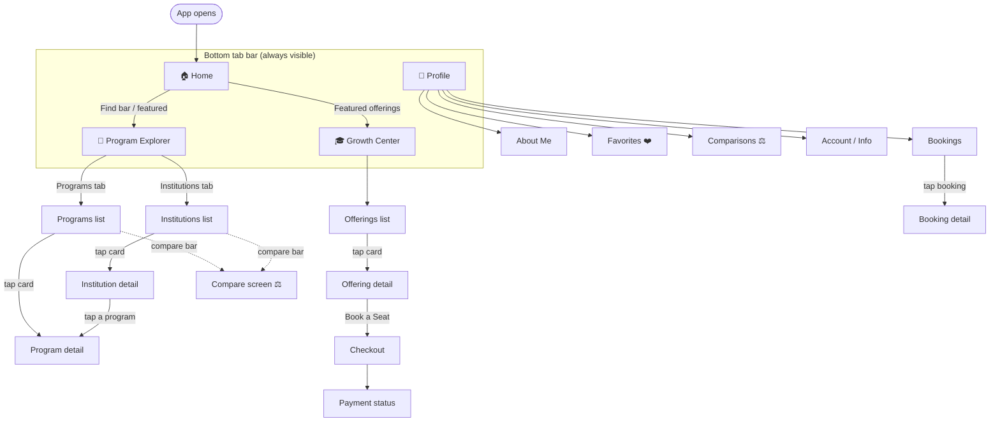

# 🧭 UniFind Mobile — Testing Guide & App Map

> For testing the app **without knowing the codebase**. It shows **every screen**, **where it lives in the code**, **which web page it mirrors**, **which backend feeds it**, and a **checklist to test everything**.
>
> The app is a mobile port of the **unifind** web product. Same data, same logins, same backends — just a native phone UI.

---

## 1. How to launch & connect

1. **Phone & computer on the same network** (same WiFi, or the computer on your iPhone's hotspot).
2. Open **Expo Go** on your phone → it connects to the dev server at `exp://<computer-ip>:3010`.
3. Current dev IP is **`192.168.1.23`** (WiFi). If you switch to hotspot, tell Claude → it flips `.env` to `172.20.10.12`.
4. **To reload after a code change:** shake the phone → **Reload** (or it auto-refreshes).

### Logged in vs Guest
- You can test **almost everything as a Guest** (browsing, search, filters, detail pages).
- **Login is needed only** for: favorites ❤️, compare ⚖️, bookings, reviews, profile, checkout.
- Login currently shows an Auth0 **"Callback URL mismatch"** error → blocked until Jamil adds the mobile callback URL in Auth0 (in progress). Until then, tap **Continue as Guest** on the sign-in sheet.

---

## 2. Navigation map (diagram)

This is a **Mermaid** diagram — it renders as a real flowchart in VS Code (Markdown Preview) or GitHub. The plain tree underneath says the same thing for the terminal.



### Plain tree (same thing)

```
App opens → Home
│
├── 🏠 HOME  (landing: find bar, featured institutions, featured offerings, guide, numbers, testimonials)
│
├── 🧭 PROGRAM EXPLORER   (two in-screen tabs at top)
│      ├── Programs  ──tap──►  Program detail
│      └── Institutions ─tap─►  Institution detail ──tap a program──► Program detail
│      └── (selecting cards builds a Compare bar → Compare screen)
│
├── 🎓 GROWTH CENTER
│      └── Offerings list ──tap──► Offering detail ──"Book a Seat"──► Checkout ──► Payment status
│
└── 👤 PROFILE   (in-screen tabs)
       ├── About Me · Profile Information · Account & Credentials · Activity
       ├── Bookings ──tap──► Booking detail
       ├── Favorites ❤️  (Programs / Institutions / Offerings sub-tabs)
       └── Comparisons ⚖️ (Programs / Institutions sub-tabs)
```

---

## 3. Page-by-page map — *which page comes from where*

Every screen you can reach, the **code file** that renders it, the **web page** it mirrors, and the **backend(s)** it reads.

> **Backends:** 🟦 **Strapi** = the read-only catalog (institutions, programs, offerings). 🟩 **Node** = your own data (favorites, compares, bookings, reviews, profile, payments). Many screens use **both**.

| # | Screen (what you see) | How to reach it | Code: route file | Code: screen | Web page it mirrors | Backend |
|---|---|---|---|---|---|---|
| 1 | **Home** | App opens / Home tab | `app/(main)/(tabs)/home.tsx` | `src/screens/HomeScreen.tsx` | `/[locale]` (landing) | 🟦🟩 |
| 2 | **Program Explorer** (Programs + Institutions tabs) | Program Explorer tab | `app/(main)/(tabs)/program-explorer.tsx` | `src/screens/find/FindScreen.tsx` | `/program-explorer` | 🟦🟩 |
| 3 | **Programs list** | Explorer → Programs tab | (inside FindScreen) | `src/screens/find/FindProgramsScreen.tsx` | `/find/programs` | 🟦🟩 |
| 4 | **Institutions list** | Explorer → Institutions tab | (inside FindScreen) | `src/screens/find/FindInstitutionsScreen.tsx` | `/find/institutions` | 🟦🟩 |
| 5 | **Growth Center** (Offerings list) | Growth Center tab | `app/(main)/(tabs)/growth-center.tsx` | `src/screens/find/FindOfferingsScreen.tsx` | `/growth-center`, `/find/offerings` | 🟦🟩 |
| 6 | **Profile** (with sub-tabs) | Profile tab | `app/(main)/(tabs)/profile.tsx` | `src/screens/ProfileScreen.tsx` | `/profile` | 🟩 |
| 7 | **Institution detail** | tap an institution card | `app/(main)/institutions/[slug].tsx` | `src/screens/institution/InstitutionDetailScreen.tsx` | `/program-explorer/institutions/[slug]` | 🟦🟩 |
| 8 | **Program detail** | tap a program card | `app/(main)/institutions/[slug]/programs/[programSlug].tsx` | `src/screens/program/ProgramDetailScreen.tsx` | `…/institutions/[slug]/programs/[id]` | 🟦🟩 |
| 9 | **Offering detail** | tap an offering card | `app/(main)/offerings/[slug].tsx` | `src/screens/offering/OfferingDetailScreen.tsx` | `/growth-center/offerings/[slug]` | 🟦🟩 |
| 10 | **Checkout** | Offering detail → *Book a Seat* | `app/(main)/offerings/checkout/[id].tsx` | `src/screens/checkout/OfferingCheckoutScreen.tsx` | `/find/offerings/checkout/[id]` | 🟩 |
| 11 | **Payment status** | after paying | `app/(main)/offerings/checkout/payment-status.tsx` | `src/screens/checkout/PaymentStatusScreen.tsx` | `…/checkout/payment-status` | 🟩 |
| 12 | **Compare** ⚖️ | select cards → Compare bar | `app/(main)/compare.tsx` | `src/screens/compare/CompareScreen.tsx` | `/compare` | 🟦🟩 |
| 13 | **Booking detail** | Profile → Bookings → tap one | `app/(main)/booking/[bookingReference].tsx` | `src/screens/booking/BookingDetailScreen.tsx` | `/profile/booking` | 🟦🟩 |
| 14 | **Terms & Conditions** | footer / links | `app/(main)/terms.tsx` | `src/screens/legal/TermsScreen.tsx` | `/terms-conditions` | — |
| 15 | **Not found** | bad link | `app/+not-found.tsx` | `src/screens/NotFoundScreen.tsx` | (404) | — |

### Profile sub-tabs (all inside screen #6)
| Sub-tab | Code | Needs login |
|---|---|---|
| About Me | `src/screens/profile/tabs/AboutMeTab.tsx` | ✅ |
| Profile Information | `…/ProfileInformationTab.tsx` | ✅ |
| Account & Credentials | `…/AccountCredentialsTab.tsx` | ✅ |
| Activity | `…/ActivityTab.tsx` | ✅ |
| Bookings | `…/BookingsTab.tsx` | ✅ |
| Favorites ❤️ (Programs / Institutions / Offerings) | `…/FavoritesTab.tsx` | ✅ |
| Comparisons ⚖️ (Programs / Institutions) | `…/ComparisonsTab.tsx` | ✅ |

---

## 4. Test checklist — *test everything*

Tick as you go. ⭐ = the core path; 🔒 = needs login.

### 🏠 Home
- [ ] ⭐ Home loads with no error, sections have spacing between them
- [ ] Find bar at top — switch between Programs / Institutions / Offerings pills
- [ ] Featured institutions scroll/show images
- [ ] Featured offerings scroll/show images
- [ ] Guide, Numbers, Testimonials sections render
- [ ] Tap a featured card → opens the right detail page

### 🧭 Program Explorer
- [ ] ⭐ Opens straight to data (no "click a tile" hub)
- [ ] ⭐ Switch **Programs ↔ Institutions** tab — header stays put, no big→small jump
- [ ] Search box filters results
- [ ] **Filter** button → drawer opens; accordion sections; active filters show a count badge
- [ ] Location filter groups by governorate; parent checkbox = indeterminate state
- [ ] Sort changes order
- [ ] Scroll down → more results load (pagination)
- [ ] Pull empty search → friendly empty state with retry

### 🎓 Growth Center (Offerings)
- [ ] ⭐ Opens straight to offerings (no error, no "Something went wrong")
- [ ] Cards show image, title, price, rating, specialists
- [ ] Filter (category / field of study / price range slider) works
- [ ] ⭐ Tap a card → **Offering detail** opens

### 📄 Detail pages
- [ ] ⭐ **Institution detail** opens (no "Not found"), all sections: overview, academics (faculty accordions expand & load programs), tuition, reviews
- [ ] ⭐ **Program detail** opens: hero, quick facts, overview, requirements, similar programs, map
- [ ] ⭐ **Offering detail** opens: hero, specialists, availability, requirements, reviews, results
- [ ] Every detail page has a **back button** (top-left)
- [ ] 🔒 ❤️ favorite toggle (prompts login as Guest)
- [ ] 🔒 ⚖️ compare toggle (programs/institutions only — not offerings)

### 💳 Booking / Checkout (🔒 login)
- [ ] Offering detail → **Book a Seat** → checkout opens
- [ ] Pick a session/time slot; price breakdown shows; promo code field
- [ ] Complete payment → payment-status screen shows success/failure
- [ ] Profile → Bookings → tap → booking detail

### 👤 Profile (🔒 login)
- [ ] About Me / Profile Information / Account show your data
- [ ] Favorites: Programs / Institutions / Offerings sub-tabs each list saved items
- [ ] Comparisons: Programs / Institutions sub-tabs show the compare table
- [ ] Bookings list

### 🌍 Cross-cutting
- [ ] Bottom tabs always visible, active tab highlighted (colored), inactive readable
- [ ] Colors look right (not washed-out / low contrast)
- [ ] Switch language to **العربية** → text translates **and layout flips RTL**
- [ ] Back button returns to the previous screen everywhere
- [ ] No red error screens

---

## 5. Two backends (so errors make sense)

| | 🟦 Strapi (catalog) | 🟩 Node (your data) |
|---|---|---|
| Holds | institutions, programs, offerings, fields, campuses | favorites, compares, bookings, reviews, profile, payments |
| Login needed | No (public read-only) | Yes (Auth0 token) |
| If it fails | a list/detail shows "Something went wrong" | favorites/compare/profile fail or show 0 |

If a **catalog** page breaks, it's usually a Strapi query issue. If a **personal** feature breaks, it's usually login/Node.

---

## 6. If something looks broken — tell Claude

Say **which screen** (use the names in section 3) and **what you saw** (error text, blank area, wrong colors, no back button). The map above lets Claude jump straight to the file. Example: *"Institution detail → academics accordion won't expand"* → that's `src/screens/institution/FacultyAccordion.tsx`.
